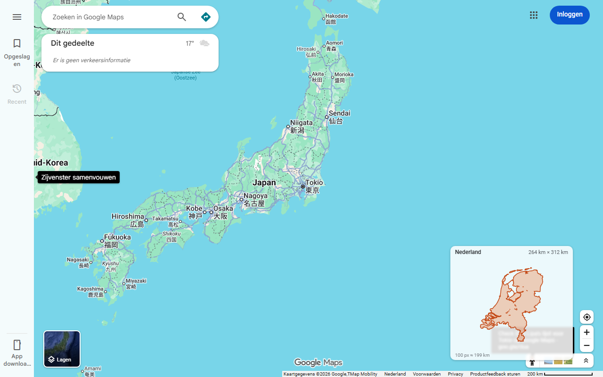

# Maps schaalreferentie / Maps scale reference

**Nederlands** hieronder, **English** further down.



---

## Nederlands

Chrome-extensie die rechtsonder in Google Maps een vorm tekent die je kent, op precies dezelfde schaal als de kaart die je op dat moment ziet. Ver uitgezoomd zie je een klein Nederland. Zoom je in, dan groeit Nederland mee tot het niet meer past, en schakelt de extensie over op je provincie, gemeente, wijk, buurt, een vierkante kilometer en ten slotte een voetbalveld. Zo heb je altijd een maat die je kent naast wat je bekijkt.

### Installeren (Chrome, Edge of Brave; Windows en Mac)

1. Download de zip: **https://github.com/HerberttenHave/maps-schaalreferentie/releases/latest**
2. Pak de zip uit (Windows: rechtsklik, Alles uitpakken; Mac: dubbelklik).
3. Open in de browser `chrome://extensions` en zet rechtsboven **Ontwikkelaarsmodus** aan.
4. Klik op **Uitgepakte extensie laden** en kies de uitgepakte map.
5. Open Google Maps. Het venster verschijnt rechtsonder zodra de kaart beweegt.

Safari en Firefox worden niet ondersteund.

### Gebruik

- Klik op het extensie-icoon en vul onder **Mijn adres** je adres in. De extensie zoekt het op bij PDOK (de Nederlandse geo-dienst van de overheid) en haalt je gemeente, wijk en buurt op uit de CBS-kaarten, met een blauw stipje op je adres. Je provincie wordt tegelijk aangezet. Alleen Nederlandse adressen; het adres blijft op je computer.
- Het venster kiest automatisch de grootste referentie die past. Bij de wissel licht de naam even oranje op.
- Klik op het venster om zelf een kleinere referentie te kiezen; bij hover verschijnen knoppen (grotere, **auto**, kleinere, verbergen). Slepen mag, de positie wordt onthouden.
- **Huidige kaartuitsnede opslaan**: zoom zo in dat een gebied het scherm vult, geef een naam en sla het op als rechthoek. Werkt overal ter wereld.
- Onderin het venster staat de schaal, bijvoorbeeld "100 px ≈ 1,2 km".

### Privacy

Geen analytics, geen cookies, geen verbinding met de maker. Alleen de adresopzoeking gaat naar PDOK, en alleen als je zelf een adres invult. Volledige tekst: [store/privacy.md](store/privacy.md).

### Hoe de schaal wordt bepaald

De extensie leest alleen de URL van Google Maps.

| URL-vorm | Betekenis | Schaal |
| --- | --- | --- |
| `@lat,lng,13.5z` | kaartweergave, zoomniveau | 156543,03 × cos(lat) / 2^zoom meter per pixel (Web Mercator, tegels van 256 px) |
| `@lat,lng,5310m` | satellietweergave | zichtbare kaarthoogte in meters, gedeeld door de vensterhoogte |
| `@lat,lng,1200a,35y,45h,60t` | 3D-weergave | benadering uit hoogte en beeldhoek, wordt als "bij benadering" getoond |

De eerste twee zijn gemeten tegen het gedrag van Google Maps, afwijking kleiner dan 0,2 procent. De kaart is in Web Mercator, dus "op dezelfde schaal" betekent: zo groot als het gebied zou zijn als het lag waar je nu kijkt.

### Bronnen

Nederland en de provincies: CBS Gebiedsindelingen 2024 (gegeneraliseerd) via PDOK. Gemeente, wijk en buurt: CBS Gebiedsindelingen en Wijk- en buurtkaart 2024 via PDOK, live opgehaald per adres. Voetbalveld: FIFA-standaardmaat 105 × 68 m.

---

## English

A Chrome extension that draws a shape you know in the bottom-right corner of Google Maps, at exactly the scale of the map you are looking at. Zoomed far out you see a small Netherlands. Zoom in and it grows until it no longer fits, then the extension switches to your province, municipality, district, neighbourhood, one square kilometre and finally a football pitch. You always have a size you know next to what you are looking at.

The built-in shapes are Dutch (the Netherlands and its provinces; address lookup covers Dutch addresses only), but you can save any area in the world as your own reference: zoom in until it fills the screen and store it from the popup.

### Install (Chrome, Edge or Brave; Windows and Mac)

1. Download the zip: **https://github.com/HerberttenHave/maps-schaalreferentie/releases/latest**
2. Unzip it (Windows: right-click, Extract all; Mac: double-click).
3. Open `chrome://extensions` in the browser and switch on **Developer mode** (top right).
4. Click **Load unpacked** and pick the unzipped folder.
5. Open Google Maps. The panel appears bottom right as soon as the map moves.

Safari and Firefox are not supported.

### Use

- Click the extension icon. Under **Mijn adres** enter a Dutch address to get your municipality, district and neighbourhood (looked up at PDOK, the Dutch national geo service) with a blue dot on your address. The address stays on your computer.
- The panel automatically shows the largest reference that fits. The name flashes orange when it switches.
- Click the panel to pick a smaller reference yourself; hovering shows buttons (larger, **auto**, smaller, hide). Drag it anywhere, the position is remembered.
- **Huidige kaartuitsnede opslaan** (save current map view): zoom until an area fills the screen, give it a name and save it as a rectangle. Works anywhere in the world.
- The bottom line shows the scale, for example "100 px ≈ 1.2 km".

The interface is in Dutch for now.

### Privacy

No analytics, no cookies, no connection to the author. The only network traffic is the address lookup at PDOK, and only when you enter an address yourself. Full text (Dutch): [store/privacy.md](store/privacy.md).

### How the scale is derived

The extension reads only the Google Maps URL: `...z` is the Web Mercator zoom (256 px tiles, metres per pixel = 156543.03 × cos(lat) / 2^zoom), `...m` in satellite view is the visible map height in metres divided by the window height, and the 3D form (`...a,...y,...h,...t`) is approximated and labelled as such. The first two were measured against Google Maps itself, within 0.2 percent.

---

## Voor ontwikkelaars / For developers

```
extension/           de extensie zelf (Manifest V3) / the extension itself
  content.js         leest de URL, kiest de referentie, tekent het venster
  references.js      gegenereerde vormen in meters (x oost, y noord)
  geo.js             projectie, vereenvoudiging, punt-in-polygoon
  pdok.js            adres en omtrekken ophalen bij PDOK
  popup.html/.js     instellingen, adres, eigen uitsnedes
tools/
  build_references.py  bouwt references.js uit PDOK GeoJSON (Python 3, shapely)
  test_pdok.js         test van de adresstroom in Node
  screenshot.js        end-to-end test en store-screenshots in headless Edge
  package.ps1          maakt dist/maps-schaalreferentie-<versie>.zip
store/               teksten, privacyverklaring en screenshots voor de Chrome Web Store
```

Ingebouwde data opnieuw genereren / regenerate built-in data:

```bash
python -I tools/build_references.py <map-met-downloads> extension/references.js
```

De downloads (`landsdeel.json`, `provincie.json`) komen van de PDOK WFS `cbs/gebiedsindelingen` (GeoJSON, EPSG:4326). Die dienst negeert `CQL_FILTER`; gebruik een OGC `FILTER=` in XML zoals `pdok.js` doet. End-to-end test met de echte extensie (Google Chrome 137+ laadt geen uitgepakte extensies vanaf de opdrachtregel, Edge wel):

```bash
MSR_BROWSER="C:\Program Files (x86)\Microsoft\Edge\Application\msedge.exe" node tools/screenshot.js store/screenshots "Straat 1, Plaats"
```

Licentie / License: MIT.
